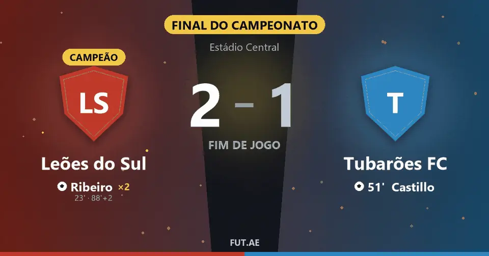
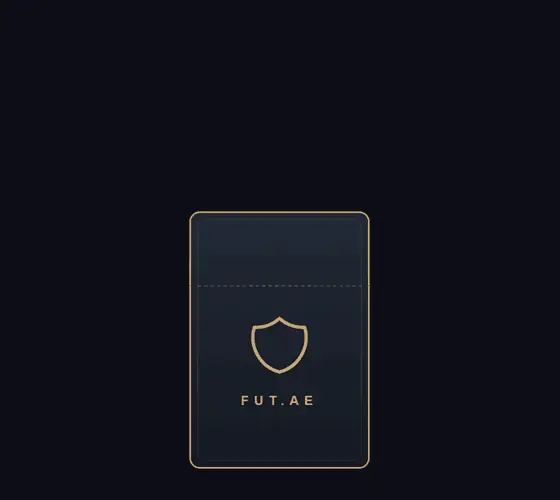
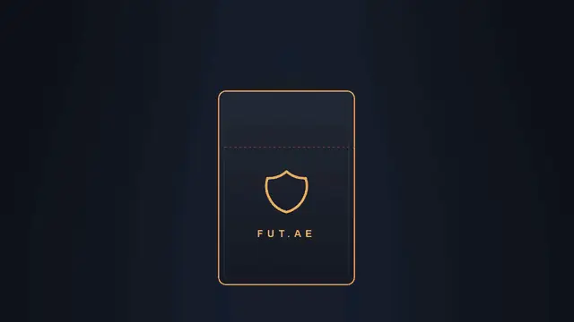
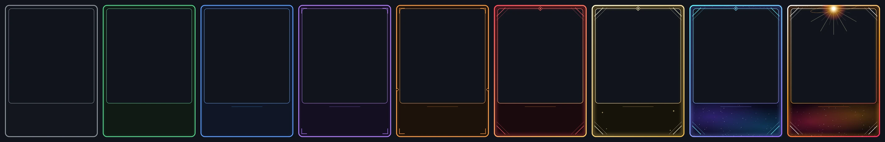

<div align="center">

# ⚽ FUT.AE

**Um jogo de futebol completo dentro do Discord: role jogadores reais, monte seu time e dispute campeonatos narrados lance a lance.**




</div>

---

## O que é

O **FUT.AE** é um bot de Discord que transforma um servidor num jogo de gestão de futebol
no estilo *gacha* (inspirado no Mudae). Os jogadores do servidor **rolam cartas de jogadores
reais**, disputam quem contrata primeiro, montam elenco e tática, e colocam os times para
jogar partidas **simuladas minuto a minuto**, com narração que edita a mensagem a cada lance e
imagens geradas pelo próprio código.

Tudo roda em Python com `discord.py`, um banco **SQLite** local com migrações idempotentes e
**Pillow** para desenhar cartas, escalações, placares e animações em GIF/WebP quadro a quadro.
Não há serviço externo obrigatório: as APIs de dados e de imagens são opcionais.

<div align="center">

&nbsp;

</div>

## Principais recursos

- **Rolls e claims** — roleta de jogadores por séries de raridade (Base → Única), ciclos de
  rolls por hora, botão de contratação com janela de exclusividade para quem rolou, *wishes* e
  *Star Wishes*, e duplicatas que viram "bolas" (+1 de overall efetivo).
- **Coleção grande, montada a partir de dados públicos** — importadores para o
  [Transfermarkt Datasets](https://github.com/dcaribou/transfermarkt-datasets), CSVs do EA FC e
  a API-Football, com cruzamento de fontes por nome e data de nascimento (sem *merge*
  automático de casos ambíguos), mais uma enciclopédia própria com 500 lendas, 100 técnicos,
  100 estádios, 100 ligas e 100 mascotes.
- **Economia** — moeda do jogo, *daily*, loja de upgrades, caixas com garantias
  (*pity*) por raridade, pacotes, inventário, missões e um "Centro de Treinamento" de 12 andares.
- **Mercado e trocas** — anúncios entre jogadores com taxa, trocas de até 5 jogadores por lado
  com confirmação dos dois lados, doações e venda em massa por filtro.
- **Time e tática** — 10 formações, estilos de jogo que se vencem em ciclo, capitão e
  cobradores, montador de escalação com menus e imagem do time desenhada por formação.
- **Motor de partidas** — força por setores e por jogador na vaga, chances, finalização contra
  o goleiro, bola parada, cartões, acréscimos e pênaltis cobrança a cobrança.
- **Competições** — amistosos (ida e volta, com apostas), liga de pontos corridos e copa
  mata-mata diárias no horário configurado, com tabela, chave, W.O. e premiação.
- **Desafios PvE** — times lendários montados na hora com as lendas da enciclopédia: escada de
  28 degraus, chefões diário e semanal, campanhas e conquistas.
- **Minijogos** — disputa de pênaltis interativa (canto secreto) e um cassino com quatro
  jogos de retorno médio de 100%, todos com animação em GIF.
- **Administração** — painel `..admin` paginado, backup comprimido do banco, comandos de teste
  da simulação e remoção segura de jogadores duplicados.

## Destaques técnicos

| Tema | Como foi resolvido |
| --- | --- |
| **Claims sem condição de corrida** | Cada contratação roda numa transação `BEGIN IMMEDIATE` no SQLite e só muda ofertas ainda `pending` (`src/rolls.py`). Dois cliques simultâneos nunca dão o mesmo jogador a duas pessoas. |
| **Migrações idempotentes** | `src/db.py` cria e evolui o schema sem apagar dados; o bot e o *worker* de fotos usam o mesmo banco com espera de *locks*. |
| **Regras do jogo dentro do SQL** | `game_overall`, `effective_overall` e `rarity_index` são funções Python registradas no SQLite em `connect()`, então consultas e código usam exatamente a mesma regra (`src/ratings.py`). |
| **Imagens 100% geradas por código** | Cartas, escalações, placares, tabelas e molduras por raridade são desenhados com Pillow; as animações (caixa, pacote, revelação, roleta, cassino, placar) são montadas quadro a quadro e mantidas em memória. |
| **Simulação explicável** | O motor (`src/simulation.py`) pondera cada titular pela vaga que ocupa, compara ataque × defesa e controle de meio, e aceita um `random.Random` injetado para testes determinísticos. |
| **Dados de várias fontes** | Importadores com `--dry-run` numa cópia temporária do banco, relatórios de revisão em CSV e respeito à cota diária da API-Football. |
| **Funciona sem fotos** | Fotos de jogadores e escudos oficiais são opcionais: sem elas, a carta usa uma silhueta e o placar, um escudo desenhado pelo código. |
| **Testes automatizados** | 450 funções de teste em 54 arquivos cobrindo banco, importadores, rolls, economia, mercado, partidas, campeonatos, imagens e registro de comandos. |

Em números: cerca de **34 mil linhas de Python** em `src/` (85 módulos) e **10 mil linhas de testes**.

## Galeria

**Molduras das cartas por raridade** (SVG gerado em `src/card_frames.py` e renderizado em PNG):



**Medalhões de cosméticos e o pacote** (ícones [Tabler](https://tabler.io/icons), licença MIT):


## Comandos principais

O prefixo é `..` (também funciona mencionando o bot). `..ajuda <comando>` explica cada um.

| Comando | O que faz |
| --- | --- |
| `..roll` | Rola jogadores; o botão contrata quem estiver livre |
| `..elenco`, `..time`, `..escalar`, `..tatica` | Elenco em cartas, time, escalação e tática |
| `..scout <nome>`, `..top`, `..left` | Busca, rankings e quanto da coleção ainda está livre |
| `..wish`, `..wishlist`, `..starwish` | Lista de desejos que influencia a roleta e os claims |
| `..daily`, `..shop`, `..upgrade`, `..crates`, `..pacote` | Economia, loja, caixas e pacotes |
| `..troca @pessoa`, `..mercado`, `..anunciar` | Trocas e mercado entre jogadores |
| `..amistoso @pessoa`, `..comparar @pessoa` | Partida narrada e comparação de times |
| `..campeonato`, `..pontos`, `..copa` | Liga e copa diárias do servidor |
| `..desafio` | Desafios contra times lendários |
| `..penaltis @pessoa`, `..cassino` | Minijogos |
| `..admin` | Painel de administração (só admins do bot) |

`/wish`, `/starwish`, `/scout`, `/vender` e `/proteger` também existem como comandos de barra,
com autocompletar do nome do jogador. O manual completo está em [`docs/manual.md`](docs/manual.md).

## Como rodar

Pré-requisitos: **Python 3.12** e um bot criado no
[Discord Developer Portal](https://discord.com/developers/applications) com o
**Message Content Intent** ativado.

```bash
git clone https://github.com/GuiMatz/futae-bot.git
cd futae-bot
python -m venv .venv
# Windows: .venv\Scripts\activate    |    Linux/macOS: source .venv/bin/activate
pip install -r requirements.txt
cp .env.example .env            # no Windows: copy .env.example .env
python -m src.db                # cria o banco data/memi.sqlite
python -m src.bot               # liga o bot
```

### Configuração (`.env`)

| Variável | Obrigatória | Para quê |
| --- | --- | --- |
| `DISCORD_BOT_TOKEN` | sim | Token do bot |
| `MEMI_OWNER_ID` | recomendada | ID de usuário do Discord do dono (acesso ao `..admin`) |
| `MEMI_ADMIN_IDS` | não | IDs de admins extras, separados por vírgula |
| `THESPORTSDB_API_KEY` | não | Fotos e escudos do TheSportsDB (sem ela, usa a chave pública de teste) |
| `API_FOOTBALL_KEY` | não | Importação de jogadores pela API-Football |
| `MEMI_CHAMPIONSHIP_SCHEDULER` | não | `0` desliga os jogos diários automáticos |
| `MEMI_NARRATION_DELAY` | não | Segundos entre os lances da narração (padrão 1,6) |

Nenhum ID de usuário, servidor ou canal fica no código: o dono e os admins vêm do `.env`, e o
canal do campeonato é configurado por servidor com `..campeonato canal #canal`.

### Dados e imagens

O bot já sobe com a enciclopédia de lendas, técnicos, estádios e ligas (`src/seeds/`).

**Fotos prontas (mais de 52 mil imagens):** os pacotes ficam na página de
[**Releases**](../../releases/latest) do repositório, fora do código para manter o clone leve:

| Pacote | Conteúdo |
| --- | --- |
| `futae-fotos-jogadores.zip` | Fotos dos jogadores (cerca de 50 mil) |
| `futae-fotos-clubes-tecnicos-estadios.zip` | Escudos de clubes, técnicos, ligas, estádios e lendas |

Extraia os dois na raiz do projeto: eles criam `data/photos/` com as subpastas que o bot usa.

Para montar a base do zero, sem os pacotes:

```bash
python -m src.import_tm            # Transfermarkt Datasets (CSV em data/raw/)
python -m src.import_ea --dry-run  # CSV do EA FC, primeiro em ensaio
python -m src.photo_worker         # fotos de jogadores via TheSportsDB
python -m src.sportsdb_images      # ligas, técnicos, estádios, lendas e times
```

Detalhes em [`docs/manual.md`](docs/manual.md) e [`docs/imagens-sportsdb.md`](docs/imagens-sportsdb.md).
As cartas personalizadas da categoria *Cartola* ficam em `src/seeds/cartola_extra.json`
(o arquivo traz apenas exemplos fictícios).

### Windows: bandeja do sistema (opcional)

```bash
pip install -r requirements-tray.txt
python futae_tray.py              # roda em segundo plano, com menu na bandeja
```

## Testes

Os testes usam bancos temporários e *mocks* do Discord; não precisam de token nem de internet.

```bash
pip install -r requirements-dev.txt
python -m pytest -q
```

## Estrutura

```
futae-bot/
├── src/
│   ├── bot.py              # ponto de entrada (python -m src.bot)
│   ├── cogs/               # comandos do Discord, um arquivo por área
│   ├── db.py               # schema, migrações e conexão SQLite
│   ├── rolls.py, game.py   # roleta, claims e coleção
│   ├── simulation.py       # motor de partidas
│   ├── narration.py, commentary*.py  # narração lance a lance
│   ├── league.py, pve.py   # competições e desafios
│   ├── *_image.py, crate_animation.py, card_frames.py  # imagens e animações
│   ├── import_*.py, api_football.py, photos.py         # coleta de dados
│   └── seeds/              # enciclopédia, lendas e índices
├── tests/                  # suíte de testes
├── scripts/                # utilitários (ícones, ilustrações, coleta de imagens)
├── assets/                 # logo, ilustrações e molduras do projeto
├── docs/                   # manual, documento técnico, guia de design e imagens
└── futae_tray.py           # inicializador na bandeja do Windows
```

## Documentação

- [`docs/manual.md`](docs/manual.md) — manual completo de comandos e regras
- [`docs/projeto.md`](docs/projeto.md) — documento técnico: fontes, modelo de dados e regras
- [`docs/guia-ideias-jogo.md`](docs/guia-ideias-jogo.md) — design do jogo e fases de implementação
- [`docs/imagens-sportsdb.md`](docs/imagens-sportsdb.md) — coleta de imagens no TheSportsDB

## Licença

Código sob a licença [MIT](LICENSE) © 2026 Guilherme Matzembacker.
Ícones Tabler sob licença MIT (`assets/ilustracoes/svg/icones/LICENSE-tabler-icons.txt`).
Nomes de jogadores, clubes e marcas pertencem aos seus titulares; o projeto não é afiliado
à EA, ao Transfermarkt, ao TheSportsDB nem à API-Football.
